# Projeto ConectaUDF - Redes sociais com grafos

## Identificação
- Nome: Luan Bispo Silva
- RGM: 32635648
- Turma: Estrutura de Dados II
- Data: 16/10
- Ferramenta utilizada: Google Colab com Python (NetworkX, Matplotlib e pandas)

---

## Contexto da atividade

### Disciplina e conteúdo
Unidade III - Grafos. Material: [Caderno do Estudante - Projeto ConectaUDF](../caderno_estudante_conectaUDF.md) (Algoritmos / Matemática Discreta / Ciência de Dados).

### Objetivo
Representar as amizades da rede social fictícia **ConectaUDF** como um grafo não dirigido; calcular graus, número de arestas e densidade; encontrar caminhos; implementar tudo em Python; ampliar a rede e propor uma forma de recomendar amizades.

### Observações sobre os dados usados
- Seções 3 a 9: usuários e amizades fornecidos no caderno, sem alteração.
- Seção 10 (Desafio em grupo): o caderno deixa a ampliação em aberto. Os 4 usuários fictícios e as 6 amizades novas foram criados para esta resolução.
- Formato da entrega: notebook do Google Colab com as explicações, os desenhos e o código. O notebook não está no repositório; este documento reúne o mesmo conteúdo e conta como ele foi construído.

---

## Como o projeto foi criado

| Etapa | O que foi feito | Ferramenta |
|---|---|---|
| 1. Escopo | Leitura do caderno e definição do formato (notebook Colab), do estilo dos desenhos (diagramas coloridos), de quem criaria os usuários do desafio e do nível do código (completo) | Caderno do estudante |
| 2. Cálculos à mão | Graus, soma dos graus, arestas, densidade e caminhos, antes de qualquer código | Papel e lápis |
| 3. Desenhos | 7 figuras com posições fixas e cores com significado (detalhes na próxima seção) | Python + Matplotlib |
| 4. Explicações | Uma analogia por conceito: aperto de mão (soma dos graus), álbum de figurinhas (densidade), pedra no lago (BFS) | Markdown |
| 5. Código | Lista de adjacência montada a partir dos pares, BFS feita à mão, recomendação por amigos em comum e desenhos com NetworkX | Google Colab |
| 6. Conferência | Notebook executado de ponta a ponta; resultados comparados com as funções do NetworkX e casos extras testados | NetworkX |
| 7. Documentação | Este documento e a atualização do README | GitHub |

### Decisões de projeto
- **Lista de amizades em vez de dicionário digitado à mão.** O código recebe cada amizade uma vez, como par `("Ana", "Bruno")`, e monta a lista de adjacência sozinho, com a "mão dupla" garantida. Assim não existe o risco de colocar Bruno na lista da Ana e esquecer a Ana na lista do Bruno.
- **BFS implementada à mão.** O NetworkX já tem `shortest_path`, mas a ideia era mostrar o algoritmo. A biblioteca entra só no fim, para conferir se a BFS própria chega aos mesmos caminhos.
- **Desafio em grupo pensado para ensinar algo.** As 6 amizades novas foram escolhidas para que:
  1. o Felipe virasse a única ponte entre a turma original e a nova (vértice de corte);
  2. Gabriel e Igor tivessem exatamente **3 amigos em comum**, ligando o desafio à pergunta de reflexão da seção 12;
  3. o desenho continuasse sem cruzamento de linhas.

---

## Os desenhos

### Por que esse layout
O grafo original foi desenhado como **triângulo + quadrado + triângulo**:
- triângulo Ana-Bruno-Carla;
- quadrado Bruno-Diego-Elisa-Carla;
- triângulo Diego-Felipe-Elisa.

Com isso, nenhuma linha cruza outra (o grafo é planar), e o desenho é fácil de copiar à mão. Há um bônus: a posição horizontal de cada usuário coincide com a distância dele até a Ana (0, 1, 2 ou 3 passos). A figura da BFS aproveita exatamente isso.

Na rede ampliada, os usuários novos formam um **losango** à direita do Felipe: Gabriel em cima, Igor embaixo, Helena no centro e Joana na ponta. Continua sem cruzamentos.

As mesmas coordenadas são usadas nas figuras e no código (dicionário `POSICOES`), então o que o código desenha bate com as imagens deste documento.

| Usuário | Posição (x, y) | | Usuário | Posição (x, y) |
|---|---|---|---|---|
| Ana | (0, 0) | | Felipe | (4.4, 0) |
| Bruno | (1.3, 1.1) | | Gabriel | (5.8, 1.1) |
| Carla | (1.3, -1.1) | | Helena | (5.8, 0) |
| Diego | (3.1, 1.1) | | Igor | (5.8, -1.1) |
| Elisa | (3.1, -1.1) | | Joana | (7.2, 0) |

### O que cada cor significa

| Figura | O que mostra | Leitura das cores |
|---|---|---|
| 1. Grafo | As 8 amizades numeradas conforme a lista do caderno | Uma cor por usuário; números nas linhas = posição na lista |
| 2. Graus | Grau de cada usuário | Laranja = grau 3, azul-claro = grau 2; selo escuro = valor do grau |
| 3. Densidade | Amizades existentes x possíveis | Linha preta = existe (8); vermelha tracejada = poderia existir (7) |
| 4. Caminhos | Os dois menores caminhos Ana → Felipe | Azul = caminho 1, laranja = caminho 2; números = ordem dos passos |
| 5. BFS | A busca se espalhando a partir da Ana | Faixas mais escuras = mais passos de distância |
| 6. Rede ampliada | Rede com 10 usuários | Azul = originais, verde = novos, linhas verdes = amizades novas, anel dourado = mais conectado |
| 7. Recomendação | Par sugerido e amigos em comum | Rosa = par sugerido, amarelo com anel = amigos em comum, curva tracejada = sugestão |

### Como foram feitos
- **Figuras 1 a 7:** Python + Matplotlib, desenhando círculos (`Circle`), linhas e legendas sobre as posições fixas da tabela acima.
- **Desenho do código:** `nx.draw_networkx_*` do NetworkX, com as mesmas posições. Usuários sem posição definida são encaixados automaticamente por `spring_layout`.
- **Versões em Mermaid:** diagramas em texto que o GitHub desenha sozinho, no mesmo estilo das outras atividades. O Mermaid escolhe o próprio layout, então a forma pode variar, mas as ligações são as mesmas.

### Ajuste feito durante a criação
Na primeira versão da Figura 7, a linha tracejada entre Gabriel e Igor passava por cima da Joana e da Helena e confundia a leitura. Ela foi trocada por uma curva que contorna a Joana pela direita.

No desenho gerado pelo código o problema era parecido: a linha da sugestão se sobrepunha às amizades da Helena. A solução foi não desenhar a linha e, em vez disso, pintar o par sugerido de rosa e destacar em amarelo os amigos em comum e as amizades que levam até eles.

---

## Seções 1 e 2 - O desafio e os conceitos

| Conceito | Na ConectaUDF | Analogia |
|---|---|---|
| Vértice (nó) | um usuário | uma pessoa na festa |
| Aresta | uma amizade | um aperto de mão |
| Grau | nº de amigos diretos | quantas mãos você apertou |
| Caminho | sequência de amigos ligados | rota de metrô, estação por estação |
| Densidade | amizades existentes ÷ possíveis | álbum de figurinhas: quanto já está colado |

O grafo é **não dirigido** porque a amizade é recíproca: se Ana é amiga de Bruno, Bruno é amigo de Ana. Já "seguir" alguém numa rede social é uma relação de mão única e pediria um grafo dirigido.

---

## Seções 3 e 4 - Usuários e desenho do grafo

### Pergunta. Desenhe o grafo.
R:

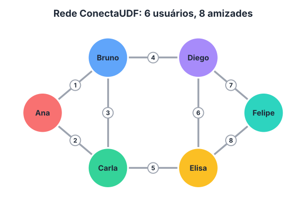

Versão em Mermaid (o número em cada linha é a posição da amizade na lista do caderno):

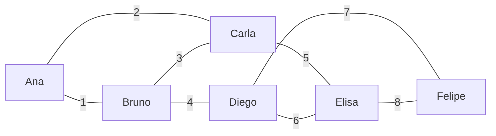

Conferência (passo 5 do caderno): aparecem as linhas de 1 a 8, sem nenhuma repetida.

---

## Seção 5 - Grau de cada usuário

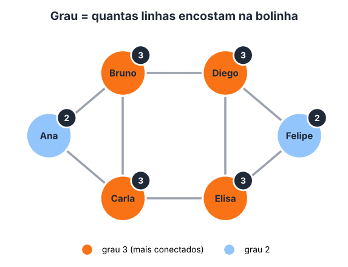

| Usuário | Amigos diretos | Grau |
|---|---|---:|
| Ana | Bruno, Carla | 2 |
| Bruno | Ana, Carla, Diego | 3 |
| Carla | Ana, Bruno, Elisa | 3 |
| Diego | Bruno, Elisa, Felipe | 3 |
| Elisa | Carla, Diego, Felipe | 3 |
| Felipe | Diego, Elisa | 2 |

### Pergunta 1. Quem tem mais conexões diretas?
R: Há um empate: **Bruno, Carla, Diego e Elisa**, com grau 3 cada. Ana e Felipe ficam nas pontas, com grau 2.

---

## Seção 6 - Número de amizades

1. Soma dos graus: 2 + 3 + 3 + 3 + 3 + 2 = **16**
2. Divida por 2: 16 ÷ 2 = **8**
3. Quantas amizades existem no grafo? **8**, o que confere com a lista do caderno.

Por que dividir por 2? Num aperto de mão entre Ana e Bruno, os dois contam "apertei uma mão". O mesmo aperto entra duas vezes na soma. Esse é o *Lema do Aperto de Mão*, e por causa dele a soma dos graus é sempre par.

---

## Seção 7 - Densidade

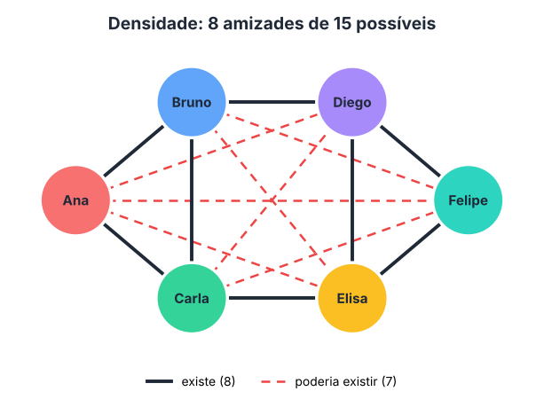

Amizades possíveis: cada um dos 6 usuários pode ser amigo dos outros 5, o que dá 6 × 5 = 30. Como Ana–Bruno é a mesma amizade que Bruno–Ana, são 30 ÷ 2 = **15**.

`D = 2 × E / (V × (V − 1)) = 2 × 8 / (6 × (6 − 1)) = 16 / 30`

- Resultado decimal: **0,5333**
- Resultado percentual: **53,33 %**

### Interprete. A rede tem poucas ou muitas das conexões possíveis?
R: Tem um pouco mais da metade: 8 de 15, como um álbum com 8 das 15 figurinhas coladas. Para 6 pessoas, é uma rede bem conectada, já que qualquer usuário chega a qualquer outro em no máximo 3 passos. Mas ainda faltam 7 amizades para todos serem amigos de todos (100 %). Redes reais grandes têm densidade muito menor, porque ninguém tem milhões de amigos; os 53 % só são possíveis porque a rede é pequena.

---

## Seção 8 - O grafo em Python

A lista de adjacência é como uma agenda de contatos: cada usuário tem a sua lista de amigos. O código do caderno foi executado sem alterações:

```python
rede = {
    "Ana": ["Bruno", "Carla"],
    "Bruno": ["Ana", "Carla", "Diego"],
    "Carla": ["Ana", "Bruno", "Elisa"],
    "Diego": ["Bruno", "Elisa", "Felipe"],
    "Elisa": ["Carla", "Diego", "Felipe"],
    "Felipe": ["Diego", "Elisa"]
}

# Quantidade de usuarios
n = len(rede)

# Calcule o grau de cada usuario
for usuario, amigos in rede.items():
    print(usuario, "tem", len(amigos), "conexoes")

# A soma dos graus conta cada amizade duas vezes
soma_graus = sum(len(amigos) for amigos in rede.values())
arestas = soma_graus // 2

print("Total de usuarios:", n)
print("Total de amizades:", arestas)

# Densidade do grafo
densidade = (2 * arestas) / (n * (n - 1))
print(f"Densidade: {densidade:.2%}")
```

Saída obtida:

```text
Ana tem 2 conexoes
Bruno tem 3 conexoes
Carla tem 3 conexoes
Diego tem 3 conexoes
Elisa tem 3 conexoes
Felipe tem 2 conexoes
Total de usuarios: 6
Total de amizades: 8
Densidade: 53.33%
```

| Trecho | O que faz |
|---|---|
| `len(rede)` | conta os usuários (V) |
| `len(amigos)` | calcula o grau de cada usuário |
| `sum(...)` | soma todos os graus |
| `// 2` | desfaz a contagem dupla do aperto de mão |
| `2 * arestas / (n * (n - 1))` | aplica a fórmula da densidade |

---

## Seção 9 - Caminho de Ana até Felipe

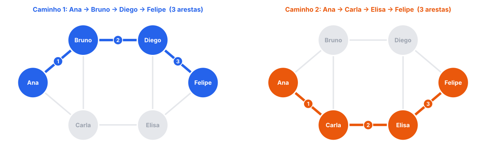

Versão em Mermaid (azul = caminho 1, laranja = caminho 2):

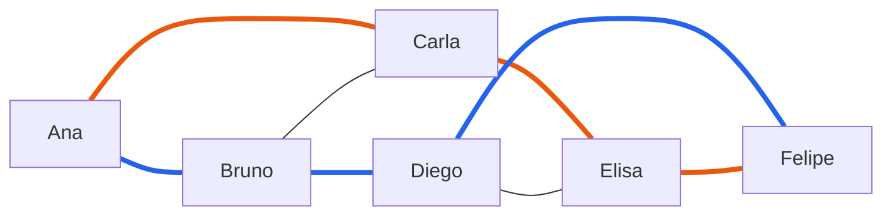

### Pergunta. Encontre um caminho de Ana até Felipe.
R: `Ana → Bruno → Diego → Felipe`

### Pergunta. Quantas arestas há no caminho?
R: 3 arestas.

### Pergunta. Você encontrou outro caminho com a mesma quantidade de arestas? Qual?
R: Sim: `Ana → Carla → Elisa → Felipe`, também com 3 arestas.

Não existe caminho menor. Ana e Felipe não são amigos, então 1 passo não basta. Eles também não têm amigo em comum (os amigos da Ana são Bruno e Carla; os do Felipe são Diego e Elisa), então 2 passos também não bastam. Caminhos mais longos existem, como `Ana → Bruno → Carla → Elisa → Felipe` (4 arestas), mas não são os menores.

O computador encontra o menor caminho com a **BFS (busca em largura)**. Ela funciona como uma pedra jogada no lago: a primeira onda alcança os amigos da Ana, a segunda alcança os amigos dos amigos, e assim por diante. A onda em que o Felipe é alcançado dá o tamanho do menor caminho.

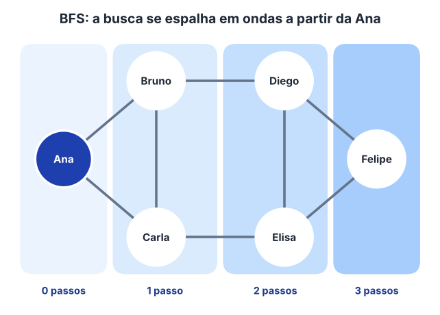

---

## Seção 10 - Desafio em grupo

### 1. Adicione pelo menos quatro usuários fictícios.
R: Gabriel (G), Helena (H), Igor (I) e Joana (J).

### 2. Crie no mínimo cinco novas amizades.
R: Foram criadas 6:

| # | Amizade |
|---|---|
| 9 | Felipe — Gabriel |
| 10 | Felipe — Igor |
| 11 | Gabriel — Helena |
| 12 | Gabriel — Joana |
| 13 | Helena — Igor |
| 14 | Igor — Joana |

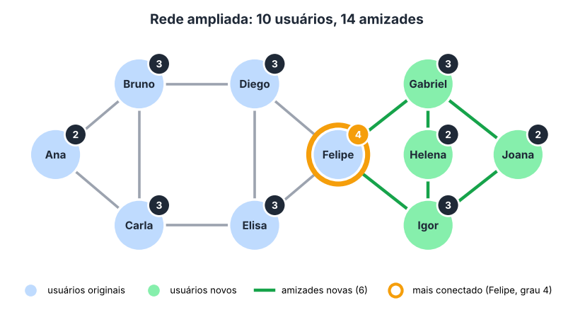

Versão em Mermaid (verde = usuários e amizades novas, amarelo = mais conectado):

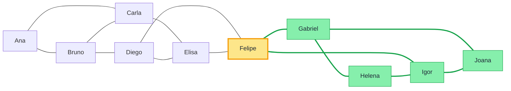

### 3. Atualize a lista de adjacência no Python.
R:

```python
rede_ampliada = {
    "Ana":     ["Bruno", "Carla"],
    "Bruno":   ["Ana", "Carla", "Diego"],
    "Carla":   ["Ana", "Bruno", "Elisa"],
    "Diego":   ["Bruno", "Elisa", "Felipe"],
    "Elisa":   ["Carla", "Diego", "Felipe"],
    "Felipe":  ["Diego", "Elisa", "Gabriel", "Igor"],
    "Gabriel": ["Felipe", "Helena", "Joana"],
    "Helena":  ["Gabriel", "Igor"],
    "Igor":    ["Felipe", "Helena", "Joana"],
    "Joana":   ["Gabriel", "Igor"],
}
```

### 4. Recalcule os graus, o total de arestas e a densidade.
R:

| Usuário | Ana | Bruno | Carla | Diego | Elisa | Felipe | Gabriel | Helena | Igor | Joana |
|---|---|---|---|---|---|---|---|---|---|---|
| Grau | 2 | 3 | 3 | 3 | 3 | **4** | 3 | 2 | 3 | 2 |

- Soma dos graus: 2+3+3+3+3+4+3+2+3+2 = **28**, logo arestas = 28 ÷ 2 = **14** (8 antigas + 6 novas)
- Densidade: `D = 2 × 14 / (10 × 9) = 28 / 90 ≈ 0,3111 = 31,11 %`

### 5. Compare a densidade antes e depois da ampliação.
R:

| | Antes | Depois |
|---|---:|---:|
| Usuários (V) | 6 | 10 |
| Amizades (E) | 8 | 14 |
| Amizades possíveis | 15 | 45 |
| Densidade | 53,33 % | 31,11 % |

A densidade caiu mesmo com 6 amizades a mais. O motivo é que as amizades possíveis crescem muito mais rápido que as reais. Com 4 pessoas a mais, as possíveis triplicaram (15 → 45), enquanto as reais nem dobraram (8 → 14). É como se o álbum ganhasse 30 figurinhas novas e só 6 fossem coladas.

### 6. Identifique os usuários com mais conexões.
R: O **Felipe**, com grau 4. Antes ele estava entre os menos conectados (grau 2) e passou a ser a única ponte entre a turma original e a nova. Se ele sair, a rede se divide em dois grupos. Em teoria dos grafos isso se chama vértice de corte, ou ponto de articulação.

### 7. Explique como a rede poderia recomendar uma nova amizade.
R: Pelo número de **amigos em comum**, a mesma ideia do "Pessoas que você talvez conheça". Para cada par que ainda não é amigo, conta-se quantos amigos os dois compartilham. Quanto mais amigos em comum, maior a chance de os dois se conhecerem. Esse princípio se chama *fechamento triádico*: se A é amigo de B e de C, B e C tendem a virar amigos.

| Par (ainda não são amigos) | Amigos em comum | Qtde |
|---|---|---:|
| **Gabriel – Igor** | Felipe, Helena, Joana | **3** |
| Bruno – Elisa | Carla, Diego | 2 |
| Carla – Diego | Bruno, Elisa | 2 |
| Felipe – Helena | Gabriel, Igor | 2 |
| Felipe – Joana | Gabriel, Igor | 2 |
| Helena – Joana | Gabriel, Igor | 2 |

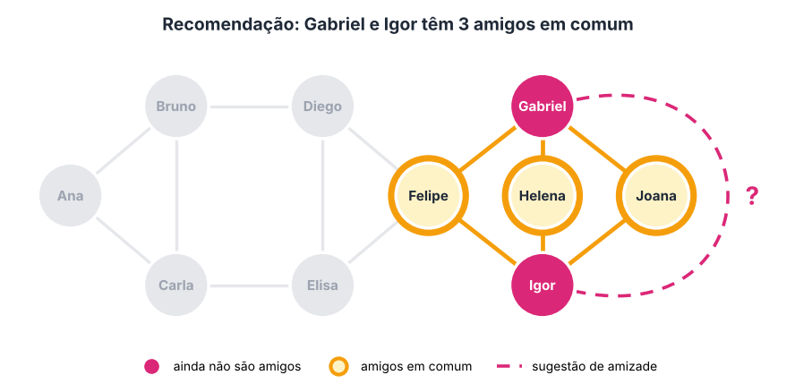

Versão em Mermaid (só a parte da rede envolvida na sugestão):

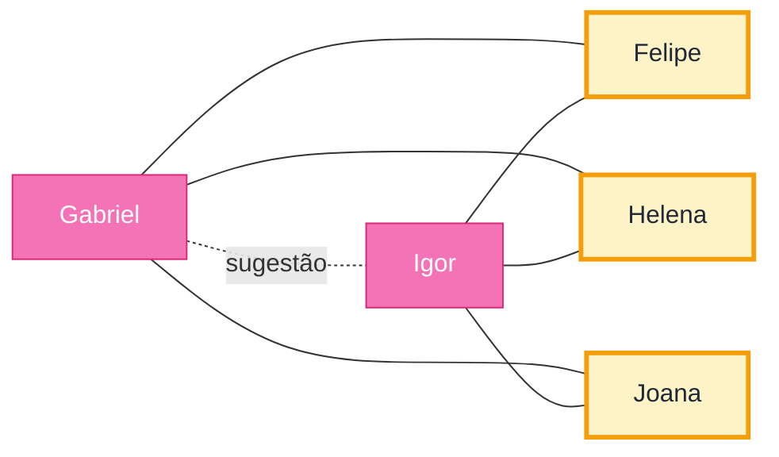

---

## Seção 11 - Entrega

| Item pedido | Onde está neste documento |
|---|---|
| Desenho do grafo | Seções 3 e 4 (Figura 1) e Seção 10 (Figura 6) |
| Tabela com os graus | Seção 5 e Seção 10, item 4 |
| Cálculos de arestas e densidade | Seções 6 e 7 e Seção 10, itens 4 e 5 |
| Código Python executável | Seção 8 e [Código completo](#código-completo-google-colab) |
| Respostas às perguntas e conclusão | Seções 5, 7, 9, 10 e 12 e [Conclusão](#conclusão) |

---

## Seção 12 - Pergunta de reflexão

### Pergunta. Duas pessoas ainda não são amigas, mas têm três amigos em comum. Como essa informação poderia ser usada para sugerir uma nova conexão?
R: Três amigos em comum indicam que as duas pessoas circulam no mesmo grupo. A rede pode sugerir a conexão em "Pessoas que você talvez conheça" e mostrar o motivo ("3 amigos em comum"), o que deixa a sugestão mais confiável. É exatamente o caso de Gabriel e Igor no desafio.

Para refinar o ranking, dá para dividir os amigos em comum pelo total de amigos distintos dos dois (*índice de Jaccard*). Assim, quem tem muitos amigos não aparece em todas as sugestões só por causa do volume.

### Pergunta. Quais cuidados de privacidade devem ser considerados ao analisar redes sociais?
R:
- **Consentimento e transparência (LGPD):** o usuário deve saber que suas conexões alimentam recomendações e poder desligar isso.
- **Não revelar quem conhece quem:** uma sugestão pode expor amizades que a pessoa deixou privadas.
- **Inferências sensíveis:** as conexões podem indicar religião, posição política, orientação sexual ou saúde, que são dados sensíveis pela LGPD.
- **Respeitar bloqueios:** nunca sugerir alguém que bloqueou o usuário, como um ex-parceiro ou um assediador.
- **Minimização e anonimização:** analisar com IDs em vez de nomes e guardar só o necessário.
- **Segurança:** um grafo social vazado vira um mapa para golpes de engenharia social.

---

## Código completo (Google Colab)

Faz tudo do projeto num único bloco: graus, arestas, densidade, menores caminhos (BFS), recomendações, desenhos e uma conferência automática com o NetworkX.

- **Como rodar:** cole o código numa célula do Google Colab e execute. Não precisa de `pip install`, porque NetworkX, Matplotlib e pandas já vêm instalados no Colab.
- **Versões testadas:** Python 3.13, networkx 3.6.1, matplotlib 3.11.2, pandas 3.0.5. Funciona com Python 3.10 ou mais recente.
- **Para mudar a rede:** edite só `AMIZADES_ORIGINAIS` e `AMIZADES_NOVAS`; o resto é recalculado sozinho.

```python
# 1) Imports e dados
from collections import deque
from itertools import combinations

import matplotlib.pyplot as plt
import networkx as nx
import pandas as pd
from IPython.display import display

# Cada amizade é digitada uma vez só; o código cria a "mão dupla"
AMIZADES_ORIGINAIS = [
    ("Ana", "Bruno"), ("Ana", "Carla"), ("Bruno", "Carla"), ("Bruno", "Diego"),
    ("Carla", "Elisa"), ("Diego", "Elisa"), ("Diego", "Felipe"), ("Elisa", "Felipe"),
]

# Desafio em grupo: 4 usuários novos e 6 amizades novas
AMIZADES_NOVAS = [
    ("Felipe", "Gabriel"), ("Felipe", "Igor"), ("Gabriel", "Helena"),
    ("Gabriel", "Joana"), ("Helena", "Igor"), ("Igor", "Joana"),
]

# Posições fixas para o desenho ficar igual ao das figuras
POSICOES = {
    "Ana": (0, 0), "Bruno": (1.3, 1.1), "Carla": (1.3, -1.1), "Diego": (3.1, 1.1),
    "Elisa": (3.1, -1.1), "Felipe": (4.4, 0), "Gabriel": (5.8, 1.1),
    "Helena": (5.8, 0), "Igor": (5.8, -1.1), "Joana": (7.2, 0),
}


# 2) Funções do projeto
def montar_rede(amizades):
    """Lista de adjacência (dict) a partir dos pares; ignora amizade repetida."""
    rede = {}
    for a, b in amizades:
        if a == b:
            raise ValueError(f"Ninguém pode ser amigo de si mesmo: {a}")
        rede.setdefault(a, set()).add(b)
        rede.setdefault(b, set()).add(a)
    return {u: sorted(amigos) for u, amigos in sorted(rede.items())}


def graus(rede):
    return {u: len(amigos) for u, amigos in rede.items()}


def total_arestas(rede):
    return sum(graus(rede).values()) // 2  # cada amizade é contada nas duas pontas


def densidade(rede):
    v, e = len(rede), total_arestas(rede)
    return 2 * e / (v * (v - 1)) if v > 1 else 0.0


def pct(x):
    return f"{x:.2%}".replace(".", ",")  # 0.5333 -> "53,33%"


def menores_caminhos(rede, origem, destino):
    """BFS (busca em largura) que devolve TODOS os caminhos de menor tamanho."""
    dist, pais, fila = {origem: 0}, {origem: []}, deque([origem])
    while fila:
        atual = fila.popleft()
        for viz in rede[atual]:
            if viz not in dist:                    # primeira vez que a "onda" chega aqui
                dist[viz] = dist[atual] + 1
                pais[viz] = [atual]
                fila.append(viz)
            elif dist[viz] == dist[atual] + 1:     # outro caminho do mesmo tamanho
                pais[viz].append(atual)
    if destino not in dist:
        return []

    def voltar(v):                                 # refaz o caminho de trás pra frente
        if v == origem:
            return [[origem]]
        return [c + [v] for p in pais[v] for c in voltar(p)]

    return voltar(destino)


def recomendacoes(rede):
    """Pares que ainda não são amigos, do maior para o menor nº de amigos em comum."""
    pares = []
    for a, b in combinations(rede, 2):
        if b not in rede[a]:
            comuns = sorted(set(rede[a]) & set(rede[b]))
            if comuns:
                pares.append((a, b, comuns))
    return sorted(pares, key=lambda p: (-len(p[2]), p[0], p[1]))


def sugerir_para(rede, usuario):
    """'Pessoas que você talvez conheça': amigos dos amigos, por nº de amigos em comum."""
    via = {}
    for amigo in rede[usuario]:
        for candidato in rede[amigo]:
            if candidato != usuario and candidato not in rede[usuario]:
                via.setdefault(candidato, []).append(amigo)
    return sorted(via.items(), key=lambda x: (-len(x[1]), x[0]))


def para_networkx(rede):
    G = nx.Graph()
    G.add_nodes_from(rede)
    G.add_edges_from((a, b) for a in rede for b in rede[a])
    return G


def relatorio(rede, nome):
    print(f"===== {nome} =====")
    tabela = pd.DataFrame(
        [(u, ", ".join(amigos), len(amigos)) for u, amigos in rede.items()],
        columns=["Usuário", "Amigos diretos", "Grau"],
    ).set_index("Usuário")
    display(tabela)
    g = graus(rede)
    v, e, soma, maior = len(rede), total_arestas(rede), sum(g.values()), max(g.values())
    print(f"Usuários (V): {v}")
    print(f"Arestas (E): soma dos graus {soma} ÷ 2 = {e}")
    print(f"Amizades possíveis: {v}×{v - 1}÷2 = {v * (v - 1) // 2}")
    print(f"Densidade: 2×{e} / ({v}×{v - 1}) = {densidade(rede):.4f} = {pct(densidade(rede))}")
    print("Mais conectados:", ", ".join(u for u, x in g.items() if x == maior), f"(grau {maior})")


CORES_CAMINHO = ["#2563EB", "#EA580C", "#16A34A", "#9333EA"]


def desenhar(rede, titulo, ax, novos=(), caminhos=(), sugestao=None):
    G = para_networkx(rede)
    pos = {u: POSICOES[u] for u in G if u in POSICOES}
    if len(pos) < len(G):  # usuário sem posição: o networkx encaixa perto dos outros
        pos = nx.spring_layout(G, pos=pos or None, fixed=list(pos) or None, seed=42)
    g = dict(G.degree())
    maior = max(g.values())
    comuns = set(rede[sugestao[0]]) & set(rede[sugestao[1]]) if sugestao else set()

    def cor(u):
        if sugestao and u in sugestao:
            return "#F472B6"                      # rosa = par sugerido
        if u in comuns:
            return "#FDE68A"                      # amarelo = amigos em comum
        return "#86EFAC" if u in novos else "#BFDBFE"

    def destaque(u):                              # borda dourada = mais conectado
        return g[u] == maior and not sugestao

    nx.draw_networkx_edges(G, pos, ax=ax, width=2.5, edge_color="#9CA3AF")
    for i, cam in enumerate(caminhos):
        nx.draw_networkx_edges(G, pos, ax=ax, edgelist=list(zip(cam, cam[1:])),
                               width=5, edge_color=CORES_CAMINHO[i % len(CORES_CAMINHO)])
    if sugestao:
        nx.draw_networkx_edges(G, pos, ax=ax, width=4, edge_color="#F59E0B",
                               edgelist=[(x, c) for x in sugestao for c in comuns])
    nx.draw_networkx_nodes(
        G, pos, ax=ax, node_size=2300,
        node_color=[cor(u) for u in G],
        edgecolors=["#F59E0B" if destaque(u) else "white" for u in G],
        linewidths=[4 if destaque(u) else 2 for u in G],
    )
    nx.draw_networkx_labels(G, pos, ax=ax, labels={u: f"{u}\n({g[u]})" for u in G},
                            font_size=9, font_weight="bold")
    ax.set_title(titulo, fontsize=12, fontweight="bold")
    ax.margins(0.12)
    ax.axis("off")


# 3) Rede original: graus, arestas, densidade e caminhos
rede = montar_rede(AMIZADES_ORIGINAIS)
relatorio(rede, "Rede original")

caminhos = menores_caminhos(rede, "Ana", "Felipe")
print(f"\nMenores caminhos Ana → Felipe ({len(caminhos[0]) - 1} arestas cada):")
for c in caminhos:
    print("  ", " → ".join(c))


# 4) Rede ampliada: comparação e recomendações
rede_ampliada = montar_rede(AMIZADES_ORIGINAIS + AMIZADES_NOVAS)
novos = sorted(set(rede_ampliada) - set(rede))
print("Usuários novos:", ", ".join(novos), "\n")
relatorio(rede_ampliada, "Rede ampliada")


def resumo(r):
    v = len(r)
    return [v, total_arestas(r), v * (v - 1) // 2, pct(densidade(r))]


comparacao = pd.DataFrame(
    {"Antes": resumo(rede), "Depois": resumo(rede_ampliada)},
    index=["Usuários (V)", "Amizades (E)", "Amizades possíveis", "Densidade"],
)
print("\nComparação antes x depois:")
display(comparacao)

print("Top recomendações (pares que ainda não são amigos):")
for a, b, comuns in recomendacoes(rede_ampliada)[:6]:
    print(f"  {a} – {b}: {len(comuns)} em comum ({', '.join(comuns)})")

print("\n'Pessoas que você talvez conheça' para o Gabriel:")
for candidato, via in sugerir_para(rede_ampliada, "Gabriel"):
    print(f"  {candidato}: {len(via)} amigo(s) em comum ({', '.join(via)})")


# 5) Desenhos
# (n) = grau · borda dourada = mais conectado · verde = usuário novo
# Último painel: rosa = par sugerido, amarelo = amigos em comum
a, b, comuns = recomendacoes(rede_ampliada)[0]
fig, axes = plt.subplots(2, 2, figsize=(16, 9))
desenhar(rede, "Rede original: 6 usuários, 8 amizades", axes[0, 0])
desenhar(rede, "Menores caminhos Ana → Felipe", axes[0, 1], caminhos=caminhos)
desenhar(rede_ampliada, "Rede ampliada (verde = usuários novos)", axes[1, 0], novos=novos)
desenhar(rede_ampliada, f"Sugestão: {a} e {b} ({len(comuns)} amigos em comum)", axes[1, 1],
         novos=novos, sugestao=(a, b))
plt.tight_layout()
plt.show()


# 6) Conferência automática: nossos cálculos x networkx
for nome, r in [("original", rede), ("ampliada", rede_ampliada)]:
    G = para_networkx(r)
    assert total_arestas(r) == G.number_of_edges()
    assert abs(densidade(r) - nx.density(G)) < 1e-12
    print(f"✔ Rede {nome}: arestas e densidade conferem com o networkx")

G0 = para_networkx(rede)
assert sorted(menores_caminhos(rede, "Ana", "Felipe")) == sorted(nx.all_shortest_paths(G0, "Ana", "Felipe"))
print("✔ BFS confere com o networkx")

print("\nMaior distância entre dois usuários (diâmetro), rede original:", nx.diameter(G0))
print("Usuário 'ponte' da rede ampliada (se sair, a rede quebra):",
      ", ".join(nx.articulation_points(para_networkx(rede_ampliada))))
```

### Saída obtida

```text
===== Rede original =====
               Amigos diretos  Grau
Usuário                            
Ana              Bruno, Carla     2
Bruno       Ana, Carla, Diego     3
Carla       Ana, Bruno, Elisa     3
Diego    Bruno, Elisa, Felipe     3
Elisa    Carla, Diego, Felipe     3
Felipe           Diego, Elisa     2
Usuários (V): 6
Arestas (E): soma dos graus 16 ÷ 2 = 8
Amizades possíveis: 6×5÷2 = 15
Densidade: 2×8 / (6×5) = 0.5333 = 53,33%
Mais conectados: Bruno, Carla, Diego, Elisa (grau 3)

Menores caminhos Ana → Felipe (3 arestas cada):
   Ana → Bruno → Diego → Felipe
   Ana → Carla → Elisa → Felipe
Usuários novos: Gabriel, Helena, Igor, Joana 

===== Rede ampliada =====
                      Amigos diretos  Grau
Usuário                                   
Ana                     Bruno, Carla     2
Bruno              Ana, Carla, Diego     3
Carla              Ana, Bruno, Elisa     3
Diego           Bruno, Elisa, Felipe     3
Elisa           Carla, Diego, Felipe     3
Felipe   Diego, Elisa, Gabriel, Igor     4
Gabriel        Felipe, Helena, Joana     3
Helena                 Gabriel, Igor     2
Igor           Felipe, Helena, Joana     3
Joana                  Gabriel, Igor     2
Usuários (V): 10
Arestas (E): soma dos graus 28 ÷ 2 = 14
Amizades possíveis: 10×9÷2 = 45
Densidade: 2×14 / (10×9) = 0.3111 = 31,11%
Mais conectados: Felipe (grau 4)

Comparação antes x depois:
                     Antes  Depois
Usuários (V)             6      10
Amizades (E)             8      14
Amizades possíveis      15      45
Densidade           53,33%  31,11%
Top recomendações (pares que ainda não são amigos):
  Gabriel – Igor: 3 em comum (Felipe, Helena, Joana)
  Bruno – Elisa: 2 em comum (Carla, Diego)
  Carla – Diego: 2 em comum (Bruno, Elisa)
  Felipe – Helena: 2 em comum (Gabriel, Igor)
  Felipe – Joana: 2 em comum (Gabriel, Igor)
  Helena – Joana: 2 em comum (Gabriel, Igor)

'Pessoas que você talvez conheça' para o Gabriel:
  Igor: 3 amigo(s) em comum (Felipe, Helena, Joana)
  Diego: 1 amigo(s) em comum (Felipe)
  Elisa: 1 amigo(s) em comum (Felipe)
✔ Rede original: arestas e densidade conferem com o networkx
✔ Rede ampliada: arestas e densidade conferem com o networkx
✔ BFS confere com o networkx

Maior distância entre dois usuários (diâmetro), rede original: 3
Usuário 'ponte' da rede ampliada (se sair, a rede quebra): Felipe
```

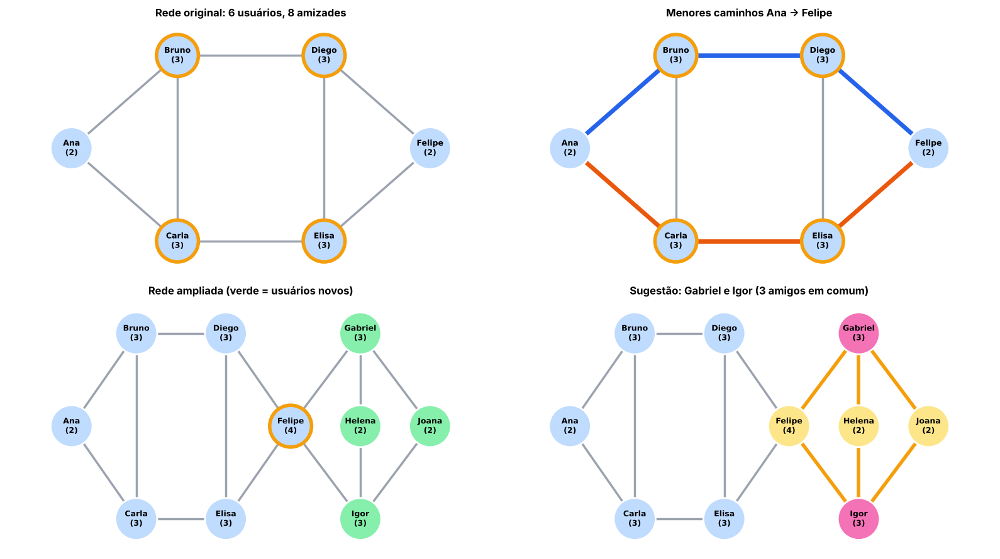

---

## Validação

Antes de entregar, conferi:
- **Graus, arestas e densidade:** calculados à mão e confirmados pelo código, nas duas redes (53,33 % e 31,11 %).
- **Conferência com o NetworkX:** número de arestas, densidade (`nx.density`) e menores caminhos (`nx.all_shortest_paths`) bateram com as funções próprias.
- **Casos extras testados:** amizade repetida (é ignorada), usuário sem posição definida (o layout automático encaixa) e usuários sem caminho entre si (a BFS devolve lista vazia).
- **Diâmetro e ponte:** diâmetro da rede original = 3 (`nx.diameter`); único vértice de corte da rede ampliada = Felipe (`nx.articulation_points`).

---

## Conclusão

O grafo transformou uma lista de amizades em algo mensurável:
- o grau mostra quem é central;
- a densidade mede o quão unida é a rede;
- a BFS encontra o menor caminho;
- os amigos em comum geram recomendações.

A ampliação mostrou duas coisas. Primeiro, redes maiores tendem a ficar menos densas. Segundo, um único usuário pode virar ponte crítica: se o Felipe sair, a rede se divide.

---

## Referência

Material de apoio: Caderno do Estudante - Projeto ConectaUDF: redes sociais com grafos (Algoritmos / Matemática Discreta / Ciência de Dados).

### Inteligência artificial utilizada
- Ferramenta: Claude (Anthropic), modelo Claude Opus 5.5
- Uso: apoio na resolução, na criação dos diagramas, no código e nesta documentação
- Data de uso: 16/10/2026
